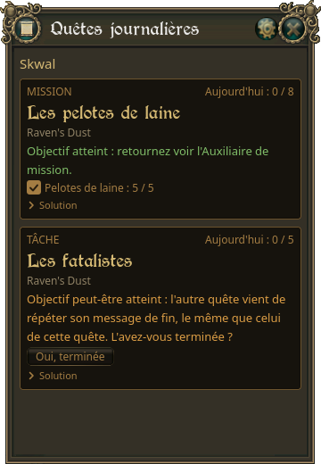

# Guide

[Accueil](../README.md) · **Guide** · [Chronométrage](chronometrage.md) · [FAQ](faq.md)

L'application lit en direct le journal du jeu (celui que le jeu écrit quand la journalisation
est activée) : elle ne touche pas au jeu et ne lui envoie rien.

## La fenêtre

- **Barre de titre** : glisser pour déplacer la fenêtre. Le coin en bas à droite la
  redimensionne. Position et taille sont gardées d'un lancement à l'autre.
- **Engrenage** : les paramètres. **Croix** : fermer l'application.
- Sous la barre de titre, le **personnage** suivi, ou la liste des personnages pour en
  choisir un.
- En dessous, une **carte pour la mission** et une **carte pour la tâche**.

## Les cartes

Chaque carte montre la quête en cours :

- **Aujourd'hui : n / 8** (missions) ou **n / 5** (tâches) : les quêtes rendues ou abandonnées
  depuis la remise à zéro du jour (5 h UTC : 7 h en été, 6 h en hiver, heure de Paris).
- Le **nom** de la quête, sa **région** et son **prérequis**.
- Le **statut** :
  - « En cours » ;
  - « Objectif atteint : retournez voir… », en vert, quand le jeu a affiché le message de
    fin de la quête ;
  - « Objectif peut-être atteint… », en orange : voir plus bas ;
  - « Limite journalière atteinte. » quand le PNJ ne donne plus de quête aujourd'hui.
- La **progression** : la dernière ligne du jeu propre à la quête, ou des **cases à cocher /
  compteurs** pour les quêtes à plusieurs étapes (« Les 4 tavernes : 2 / 4 »…).
- **Solution** : la solution du wiki Neerya, repliée par défaut (cliquer pour l'ouvrir). Les
  coordonnées y sont surlignées.

Les deux cartes sont suivies en même temps. Une carte peut être masquée dans les paramètres
(la quête reste suivie).

### Objectif peut-être atteint

Beaucoup de quêtes finissent par le même message du jeu : « Vous avez trouvé ce que vous
cherchiez. » Si la mission et la tâche en cours peuvent toutes les deux l'afficher,
l'application ne devine pas : les deux cartes passent en orange avec un bouton
**« C'est cette mission »** / **« C'est cette tâche »**. Cliquez celui de la quête terminée.

Sans réponse, le doute se lève tout seul : au second message (les deux sont finies), quand
vous rendez l'une des deux quêtes, ou quand vous en prenez une nouvelle.

Le même message répété dans les 45 secondes (on continue de tuer après l'objectif) est
ignoré. Sauf si l'autre quête en cours peut finir par ce message et ne l'a pas encore fait
(des tarentules près des fatalistes, par exemple) : sa carte passe en orange avec un bouton
**« Oui, terminée »**. Sans réponse, elle reste en cours jusqu'à son propre message de fin ou
jusqu'à ce que vous la rendiez.

### Une quête prise avant de lancer l'application

Au lancement, l'application relit les journaux d'hier et d'aujourd'hui : une quête prise
pendant ce temps est retrouvée. Une quête plus ancienne apparaît dès que le PNJ vous la
rappelle (parlez-lui) : « En cours (retrouvée grâce à un rappel du PNJ) ».

## Le personnage suivi

- **Un seul client du jeu ouvert** : l'application suit le personnage qui joue. Si vous
  changez de personnage, elle le suit.
- **Plusieurs clients ouverts** : tous les journaux bougent (discussions, joueurs proches),
  donc l'application ne change pas de personnage toute seule : choisissez-le dans la liste.
- La liste montre les personnages actifs dans la dernière heure.
- Jeu fermé : rien n'est affiché.

## Les paramètres

| Paramètre | Effet |
|---|---|
| Dossier des logs du jeu | Détecté automatiquement. Sinon, « Parcourir… » pour le choisir, « Détecter » pour revenir à la détection. |
| Opacité | Transparence de la fenêtre. |
| Toujours afficher les solutions | Solutions dépliées sur les cartes. |
| Afficher les missions / les tâches | Masque une carte (pas les deux). La quête reste suivie. |
| Chronométrer les quêtes | Chrono, temps moyen et xp/h des quêtes : voir [Chronométrage](chronometrage.md). |
| Ouvrir le dossier des logs de l'application | Les fichiers de l'application (journaux, temps des quêtes). |
| Journaliser toutes les lignes du jeu (débogage) | Copie chaque ligne du jeu dans le journal de l'application. Utile seulement pour signaler un problème. |
